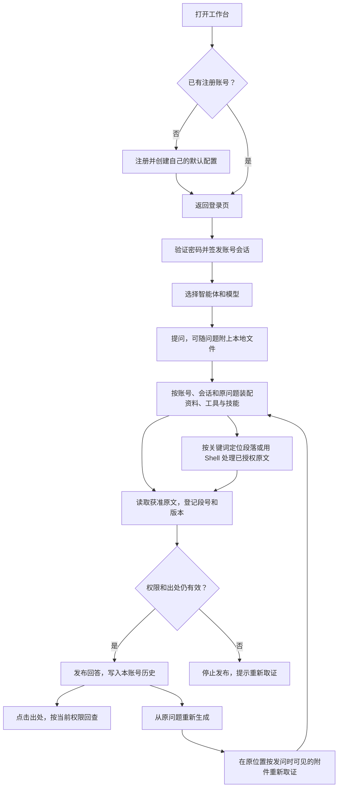

# 材料工作台实施计划与数据流

从仓库根目录运行 `uv run python -m examples.tickets.app`。当前宿主与三份来源放在同一个示例包，核心负责会话、受限工具调用和结果发布。[入口](../../examples/tickets/app.py)

| 切片 | 代码落点 | 复验方式 |
| --- | --- | --- |
| 注册与登录 | [账号存储和路由](../../examples/tickets/accounts.py)、[登录与注册表单](../../src/biu_agent/web/login.html) | 注册不签发登录凭证，重复注册不覆盖密码，升级后已有账号能登录 |
| 独立配置 | [配置注册表](../../examples/tickets/config.py) | 两个账号分别修改技能与权限，再回读自己的配置 |
| 来源与上下文 | [来源适配](../../examples/tickets/corpus.py)、[每轮装配](../../examples/tickets/workspace.py) | 比较全资料和受限范围，试验文件版本变化和调用中撤权 |
| 对话与历史 | [会话](../../src/biu_agent/session.py)、[中文工作台](../../src/biu_agent/web/workspace.js) | 核对历史归属、复制、反馈、重生成与同源嵌入 |
| 会话附件与技能 | [文件分段](../../src/biu_agent/agents/context/attachments.py)、[技能目录](../../src/biu_agent/agents/skills)、[文本工具](../../src/biu_agent/agents/tools) | 发送虚构文件、搜索与 Shell 取证、用另一个账号复核范围、往返导入导出 SKILL.md |
| 教学评测 | [本地测试](../../tests/test_material_workspace.py)、[可选观测](../../integrations/langfuse/README.md) | 分别保存本地、浏览器、真实模型与可选服务的证据 |

按[材料教程](../../tutorials/00-material-workspace/README.md)逐步运行，当前完成情况见[验证记录](../features/FEAT-20261120-assistant-workspace/evidence.md)。
