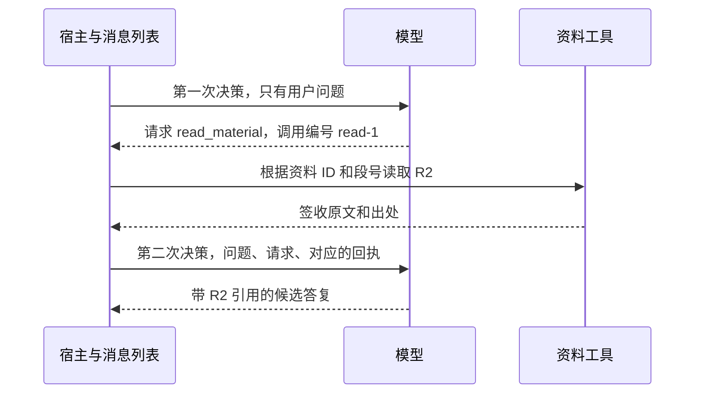

# 01 · Agent loop 怎样用一条工具回执决定下一步

“导向牌到了吗？”和“导向牌验收通过了吗？”只差几个字，证据要求却不同。收货点在 R2 签了收，验收说明 A2 只列了样品灯。如果助手只读到 R2，此时可以回答哪一问？再给它一次查询机会，它应该读什么？本课把这两个决定放进代码里。[到货原文](../../examples/tickets/data/receiving.md) · [验收原文](../../examples/tickets/data/acceptance.md)

learn-claude-code 的第一课把一次命令输出送回模型，让它接着决定做什么。公众号第一篇则让手写循环和 AgentScope 查询同一组延期项目。本课从这两种做法各取一步。先用十几行 Python 追一条签收回执，再让两种实现核对同一批展具，比较模型收到的证据和宿主给出的结束原因。[learn-claude-code 第一课](https://github.com/shareAI-lab/learn-claude-code/blob/main/s01_agent_loop/README.zh.md) · [公众号原文](https://mp.weixin.qq.com/s/9sOhhqU2_ML7aORLdMCojQ) · [本课完整代码](code.py)

## 一、什么是 Agent loop

**Agent loop 是宿主反复把当前状态交给模型、执行它请求的动作、把观察结果加入状态，再决定是否继续的控制过程。** 这里的“宿主”就是正在运行的 Python 程序。“观察”有具体的数据形态，例如资料工具返回的原文、段号，或者一次读取失败的回执。

一次**用户提问**可以包含多次**模型调用**。一次模型调用又可以产生零个、一个或多个**工具请求**。先把这三个计数分清，后面才能算清预算、定位漏读，也才能解释为什么“模型调用三次”会对应五份工具回执。

把本课与固定工作流放在一起看。工作流可以预先写好“读 R2，再读 A2，再汇总”。在 Agent loop 中，宿主提供可用工具，下一步由决策函数根据眼前的消息选择。目录为空时可以当场说明缺口。为了让每位读者复现同一条轨迹，本课用确定性的教学模型做决策，资料查询和 SDK 调度则实际执行。

| 在代码里找什么 | 本课中的对象 | 它回答的问题 |
| --- | --- | --- |
| 任务和状态 | 用户问题、`messages` | 此次决策能看到哪些信息？ |
| 动作 | `Call`，完整版本用 `ToolCallBlock` | 模型想调用哪个工具，参数是什么？ |
| 观察 | `Result`，完整版本用 `ToolResultBlock` | 宿主实际做了什么，返回了什么？ |
| 结束条件 | 候选答复、响应异常、迭代预算 | 本轮因何停止，能否把文字交给用户？ |

## 二、循环的原理，从 R2 的两次决策讲起

### 2.1 谁提出请求，谁能看到文件

最小版本只会处理签收这一问。第一次调用 `decide_receipt` 时，消息末尾是用户问题，函数提出读取 `receiving/R2`。第二次调用时，如果末尾已经是工具结果，它才交出带出处的文本。这个函数全程没有打开过文件。[读取请求与实际文件入口](code.py#L50-L61)

[源码 · 离线决策函数](code.py#L50-L54)

```python
def decide_receipt(messages):
    last = messages[-1]
    if isinstance(last, Result):
        return last.value
    return Call("read-1", "read_material", {"id": "receiving", "section": "R2"})
```

负责访问文件的是 `dispatch(action)`。宿主把它的结果与 `action.id` 装进同一个 `Result`，随后有两行看起来很像，却通往不同的地方。`messages.append(result)` 改变下一次决策的输入，`observe(result)` 让运行这段代码的人看到日志。[请求与回执的数据类型](code.py#L19-L29)

[源码 · 最小反馈循环](code.py#L36-L47)

```python
def run_loop(question, decide, dispatch, *, steps=3, observe=print):
    messages = [question]
    for _ in range(steps):
        action = decide(messages)
        messages.append(action)
        observe(action)
        if isinstance(action, str):
            return action
        result = Result(action.id, dispatch(action))
        messages.append(result)
        observe(result)
    raise StepLimit(f"{steps} 次模型决策已用完")
```



### 2.2 从单个动作扩展到同轮多个请求

现在同时核对两件事。样品灯和导向牌各自是否签收？验收说明覆盖哪些物品？手写版本 `run_manual` 复用 AgentScope 的消息类型和工具执行器，由我们写代码决定怎样保存状态、何时执行下一轮。它把系统指令和用户问题分别建成消息，把工具声明随请求交给教学模型。收到响应时先保留**完整的内容块**。如果同一次响应里既有解释文字又有工具请求，单存文字会丢失工具名、参数和调用编号。

[源码 · 保存完整响应并选择后续动作](code.py#L110-L119)

```python
for _ in range(steps):
    response = await model(messages, tools=schemas)
    if not response.is_last or response.finished_reason != "completed":
        return "incomplete_response", None
    reply = AssistantMsg("biu", response.content)
    messages.append(reply)
    calls = [b for b in reply.content if isinstance(b, ToolCallBlock)]
    if not calls:
        text = reply.get_text_content()
        return ("completed", text) if text and text.strip() else ("empty_answer", None)
```

目录一旦返回，模型就可以一次索取四段原文。本课顺序执行这一批动作。`Toolkit.call_tool` 会产出执行过程中的数据，每项调用的最终回执是 `ToolResponse`。其中的 ID 来自原始请求。`run_manual` 先拒绝同批次重号，再把每份终态回执连同其 ID、工具名和状态写回消息。这里按顺序执行，因此结果的 ID 序列应该与请求序列完全一致。某项缺失或错配时，返回 `incomplete_tool_batch`，宿主可以就地诊断这次中断。

[源码 · 逐项配对，再整批回填](code.py#L121-L138)

```python
request_ids = [call.id for call in calls]
if len(set(request_ids)) != len(request_ids):
    return "duplicate_call_id", None
results = []
for call in calls:
    async for event in toolkit.call_tool(call, state):
        if isinstance(event, ToolResponse):
            results.append(
                ToolResultBlock(
                    id=event.id,
                    name=call.name,
                    output=event.content,
                    state=event.state,
                )
            )
if [result.id for result in results] != request_ids:
    return "incomplete_tool_batch", None
messages.append(AssistantMsg("biu", results))
```

这里的 `AssistantMsg`、`ToolCallBlock` 和 `ToolResultBlock` 是 AgentScope 在进程内使用的对象。若直接对接 Chat Completions，模型的调用请求在 assistant 消息的 `tool_calls` 里，工具消息通过 `tool_call_id` 关联原请求。SDK 的格式化器负责协议转换。排查回填时，可以在模型入口验证同一件事。**下一次输入中能否找到上一批每个请求对应的结果？** 仓库的本机协议测试也从服务端检查了第二次请求中的工具消息。[工作台的模型协议实验](../../tests/test_material_connections.py#L40-L70)

配对时也要保留失败。一笔调用带着原 ID 返回 `state=error`，下一轮便能看到错误并修正参数。如果调用结束后连终态回执都缺失，宿主就失去了判断其结果的依据。本课在后一种情况下退出。可以沿着第二课的 R9 实验看一份能正常配对的错误回执。[第二课的错误输入](../s02_tools/README.md)

### 2.3 交给 AgentScope 后，宿主还负责什么

`run_framework` 把同一套工具、模型、问题和指令交给 `Agent`，通过 `ReActConfig(max_iters=steps)` 设置推理与行动的迭代上限。模型的每次调用、工具执行和消息回填由框架驱动。应用仍要读取结束原因、决定哪些文本可以交付。[Agent 构造与配置](code.py#L142-L151)

[源码 · 从 SDK 事件中分别取得结束原因与文本](code.py#L152-L161)

```python
reason, text = "incomplete_response", None
async with aclosing(agent.reply_stream(UserMsg("user", question), yield_final_msg=True)) as stream:
    async for event in stream:
        if isinstance(event, ReplyEndEvent):
            reason = event.finished_reason
        elif isinstance(event, Msg):
            text = event.get_text_content()
if reason == "completed" and not (text and text.strip()):
    return "empty_answer", None
return reason, text if reason == "completed" else None
```

收到最后的文字只说明有一段候选答复。在材料工作台，`run_turn` 还会复核权限和完成原因，`Workspace.verify` 会检查引用是否来自本轮实际读取的段落，并核对材料版本。即使 R2 引用真实存在，也要读原文才能判断“已通过验收”这个结论是否成立。[工作台运行入口](../../src/biu_agent/agent.py#L49) · [出处检查](../../examples/tickets/workspace.py#L191)

## 三、实战，从一次读取到两种循环同题比对

### 实验一 · 工具已成功，为什么还没有最终回答

使用 Python 3.12，在仓库根目录安装锁定依赖。以下用 `python -m` 从同一目录启动课程模块，方便同时导入工作台的材料和教学模型。下列练习均在本机运行，无需配置模型密钥。

```sh
uv sync --locked
uv run --no-sync python -m tutorials.s01_agent_loop.code
uv run --no-sync python -m tutorials.s01_agent_loop.code --steps 1
```

默认命令输出三行。第一行只能证明模型请求读取 R2。第二行才是工具返回的事实。第三行是第二次决策产出的候选答复。

```text
Call(id='read-1', name='read_material', args={'id': 'receiving', 'section': 'R2'})
Result(call_id='read-1', value='收货点已签收一块导向牌，待安排检查。 [receiving#R2]')
收货点已签收一块导向牌，待安排检查。 [receiving#R2]
```

再看 `--steps 1`。前两行照常出现，最后一行变成「1 次模型决策已用完」。这一份预算已经用在提出读取请求上。工具可以在本步执行，但把原文变成候选答复还需要下一次决策。

### 实验二 · 用五份回执解释三次模型调用

```sh
uv run --no-sync python -m tutorials.s01_agent_loop.code --engine manual --trace
uv run --no-sync python -m tutorials.s01_agent_loop.code --engine agentscope --trace
```

两条命令共用 `review_toolkit` 和 `TeachingModel`。前者只提供目录和段落读取，后者读取目录回执后才生成具体段号。`ObservedModel` 在模型入口统计此刻**输入里**的回执，方便区分“工具执行过”和“结果真的进入下一轮”。调用 ID 在每次运行时重新生成，请在同一次运行中配对。`--trace` 会再次打印历史回执，统计工具执行次数时只计不同的请求 ID。[同题装配](code.py#L164-L172) · [输入观测位置](code.py#L91-L103) · [教学模型如何选段](../../examples/tickets/teaching_model.py#L30)

| 第几次模型调用 | 已收到的回执 | 此次模型能做出的决定 |
| --- | --- | --- |
| 1 | 0 | 请求 `list_materials`。此时连可见的段号都还没有拿到 |
| 2 | 1 份目录 | 取 R1、A1、R2、A2，产生四个各有 ID 的 `read_material` 请求 |
| 3 | 1 份目录 + 4 份原文 | 按证据回答。R1、R2 支持两项签收，A1、A2 支持样品灯通过检查，导向牌缺少验收依据 |

两种实现的正常路径都以 `completed` 结束。选一条第二次调用产生的 `请求`，把其 ID 与第三次输入中打印的 `收到` 对上。再检查最终文字里的 `[receiving#R2]`。前一个 ID 帮开发者追踪执行，后一个定位符让读者打开原文。

注意最后两项材料各自能证明什么。R2 的“待安排检查”是收货点当时记录的状态，A2 给出本次验收记录的覆盖范围。两者合在一起，可以说这份材料没有证明导向牌通过验收。如果把答复写成“导向牌验收失败”，即使两个引用都能打开，这个结论也超出了原文。

### 实验三 · 改动授权或预算，预测哪一步发生变化

```sh
uv run --no-sync python -m tutorials.s01_agent_loop.code --engine manual --scope receiving
uv run --no-sync python -m tutorials.s01_agent_loop.code --engine manual --scope empty
uv run --no-sync python -m tutorials.s01_agent_loop.code --engine manual --steps 1
uv run --no-sync python -m tutorials.s01_agent_loop.code --engine agentscope --steps 1
```

| 改动 | 本地观察 | 如何解释 |
| --- | --- | --- |
| 只给到货记录 | 仍调用模型 3 次，输入回执数变为 0、1、3 | 可见目录只给出 R1、R2。可以确认签收，回答说明缺少验收依据 |
| 授权集合为空 | 模型调用 2 次，目录回执为一份，答复说明没有可读材料 | 空目录本身也是一个有效的观察，足以决定停止 |
| 手写循环只给一步 | 模型调用 1 次，`budget_exhausted` | 已完成目录查询，轮数耗尽，宿主没有取得候选答复 |
| 框架只给一次迭代 | 模型入口实测 2 次，最终为 `exceed_max_iters` | 本仓库锁定的 AgentScope 2.0.10 在这个路径上还会做一次收尾模型调用。本章按结束原因处理，超限时不输出候选答复 |

公众号第一篇使用 AgentScope 2.0.12。本仓库锁定 2.0.10，表中的调用次数来自本章的离线实验。模型服务的超时、计费和重试需要在实际接入时分别计量。本课的 `--steps` 控制的是循环预算。[本仓库的依赖版本](../../pyproject.toml)

**动手验证。** 在临时副本中注释最小循环的 `messages.append(result)`，保留紧随其后的 `observe(result)`，再用三步预算运行默认题。先写下预计会读几次文件，再看终端。终端会显示三次读取。每次都打印出原文，但下次决策看到的最后一条消息仍是 `Call`，于是继续申请读取。恢复这一行，文件只读一次，第二次决策就能结束。

## 四、总结与自检

接手一条循环轨迹时，可以从结论往回找。回答里的“导向牌已签收”对应 R2 的哪句话？这段话随哪个调用 ID 回到了模型输入？宿主最后以什么原因退出？这三个问题分别检查业务证据、消息回填和运行状态。把题目换成“列出所有延期项目”，第一步就该查看项目目录是否遍历到了末页，随后再对照每项结论的详情记录。

接下来拆开 `read_material`，看合法请求如何获得原文，以及为什么一次成功的调用仍可能漏掉第二页。[02 · 工具调用的设计与实现](../s02_tools/README.md) · [课程目录](../README.md)
