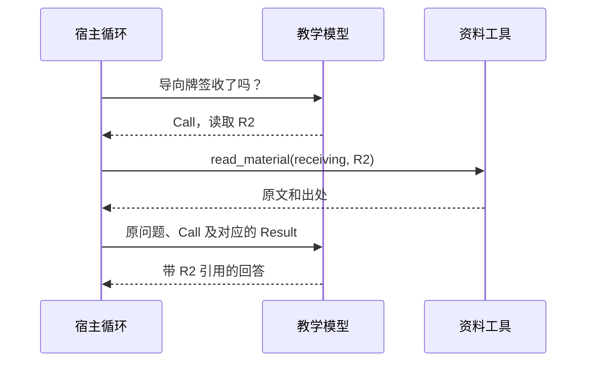

# 01 · Agent loop 怎样把工具结果带回模型

问「导向牌签收了吗？」。第一步模型只能提出读取请求。即使宿主已经读到原文，模型也要再得到一次发言机会，才能根据那段原文回答。这一课把两次决策都打印出来。[完整代码](code.py)

## 先跑一次

首次在仓库根目录用 Python 3.12 和 `uv sync --locked` 安装依赖。以下命令使用教学决策函数，无需模型密钥。

```sh
uv run --no-sync python -m tutorials.s01_agent_loop.code
uv run --no-sync python -m tutorials.s01_agent_loop.code --steps 1
```

第一次会依次看到 `Call(id='read-1', ...)`、`Result(call_id='read-1', ...)`、带 `[receiving#R2]` 的最终回答。第二次仍然能读到 R2，最后一行却是「1 次模型决策已用完」。**工具完成和回答完成发生在不同的步骤。**

## 沿着一条消息读循环



打开 `run_loop`。第一个参数是问题，`decide` 接收当前消息列表，`dispatch` 是宿主提供的执行入口。先看循环中间这几行。

```python
action = decide(messages)
messages.append(action)
observe(action)
if isinstance(action, str):
    return action
result = Result(action.id, dispatch(action))
messages.append(result)
```

1. 第一遍，列表中只有问题。离线函数 `decide_receipt` 固定提出 `read_material(receiving, R2)`。替换为在线模型时，这个决定来自模型响应中的工具调用块。
2. `read_receipt` 才真正打开已登记材料。宿主保存模型的请求，再用同一个 ID 把返回的文本挂到请求上。如果以后一次请求多段原文，ID 可以区分每一份回执。
3. 第二遍，列表末尾是 `Result`。`decide_receipt` 取出它的值形成文本，循环返回。步数上限限制的是调用决策函数的次数。

**动手验证。** 暂时注释掉 `messages.append(result)`，保留打印，再跑第一条命令。你会看见 R2 被反复读到，最终撞上步数上限。解释这个现象时，指出「终端看到的结果」和「下一遍传给 `decide` 的内容」分别来自哪一行，然后恢复该行。

## 回到工作台

工作台把循环交给 AgentScope。`run_turn` 消费 `agent.reply_stream` 的事件，用完成原因和最终消息决定这轮能否结束。离线工作台的 `TeachingModel` 同样检查工具回执，且可以一次请求多个段落。对着这两个函数，可以找到刚才手写的决策和停止条件。[运行入口](../../src/biu_agent/agent.py) · [教学模型](../../examples/tickets/teaching_model.py)

下一课给读取请求加上参数契约。[02 · 工具](../s02_tools/README.md)
