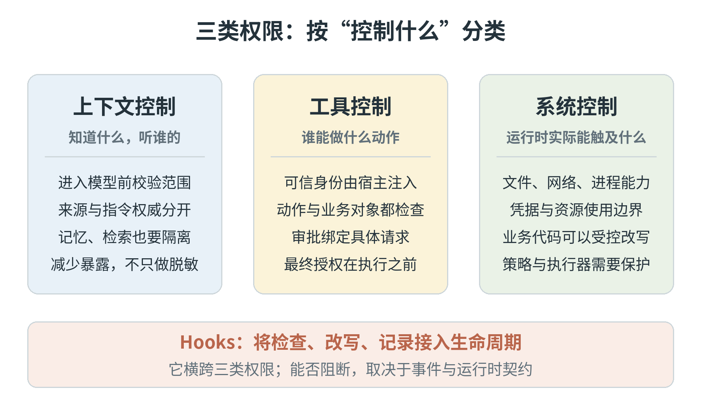
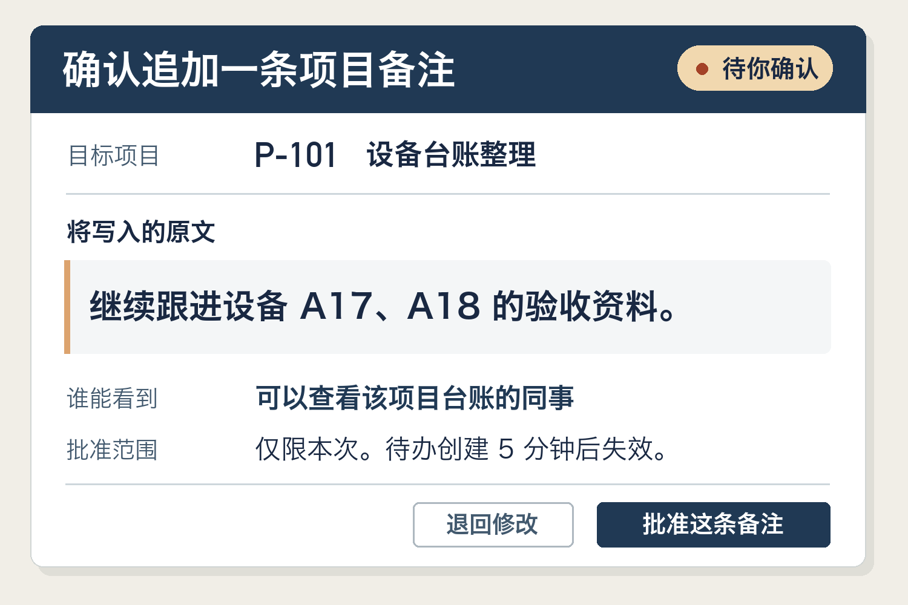
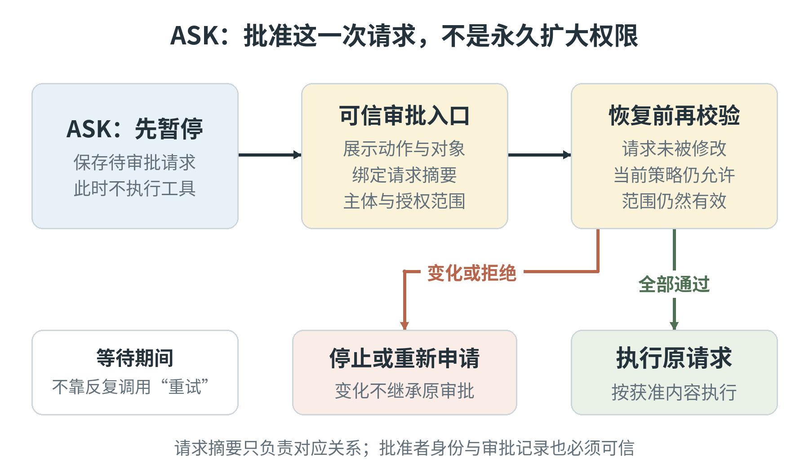

# 03 · 能查一个项目，什么时候才能给它加备注？

小舟请助手查一下 P-101，再加一条备注，提醒同事跟进设备 A17、A18 的验收资料。两件事在一句话里。查进度时，程序要决定哪些字段可以进入模型输入。加备注时，明天打开共享台账的同事都会看到这句话。假如小舟还在看确认单的时候项目移交了，谁来阻止旧请求写进去？

这一课和下一课共同还原 Eric《Agent 权限与 Hooks》第三篇的虚构项目。先用固定请求解释宿主如何处理读取、拒绝、等待和恢复，再去下一课看 AgentScope 真正暂停的地方。本课还保留了展具工作台的撤权实验，方便把项目级规则对应到日常使用的会话和出处。[完整代码](code.py) · [第四课的执行过程](../s04_hooks/README.md)

## 一、权限判断需要哪些输入

登录认证让宿主知道“来的人是谁”。**授权判断**接着回答“这个人在此刻能否对这个对象执行这个动作”。这里的身份由已认证的租户和用户确定，对象是项目，动作可以是读取进展或追加共享备注。`P-104` 和 `P-101` 都符合项目编号格式。模型能构造合法编号，还要经过对象授权才能取到数据。



从左向右读第三篇的这张图。上下文权限决定送给模型哪些材料，工具权限决定某次读写是否能继续，系统权限决定运行进程实际上能访问哪些文件和服务。下面的程序可以验证前两项。把进程放进容器、限制网络或凭据，需要在部署环境单独验证。

| 请求 | 本课策略 | 可观察结果 |
| --- | --- | --- |
| 展具组的小舟查自己负责的 P-101 | `ALLOW` | 返回编号、名称、进度三个字段 |
| 同一人读范围外的 P-104 | `DENY` | 不能据此取得该项目的内容 |
| 同一人给 P-101 加共享备注 | `ASK` | 创建一份有时限的待办，此时台账仍是 0 条 |

## 二、先筛模型输入，再判断写操作

[源码 · 对象授权与模型可见字段](code.py#L32-L42)

```python
def decision(actor, grants, project, action):
    if (actor.tenant_id, project) not in PROJECTS or project not in grants:
        return "DENY"
    return {"read": "ALLOW", "append_note": "ASK"}.get(action, "DENY")


def model_view(actor, grants, project):
    if decision(actor, grants, project, "read") != "ALLOW":
        raise hidden()
    row = PROJECTS[actor.tenant_id, project]
    return {"id": project, "name": row["name"], "progress": row["progress"]}
```

沿着 `model_view` 读。`decision` 先用租户与项目编号查找对象，并检查该项目是否在宿主传入的授权集合中。通过读取检查之后，函数显式挑出三个字段。底层记录还带着 `budget`，它没有进入返回的字典。这里打印的是准备交给模型的投影，整个权限实验无需发起模型请求。[虚构数据和身份](code.py#L14-L19)

工作台的材料使用类似的顺序。`inspect_scope` 先取部署方范围与智能体选项的交集，然后用相同范围列目录、直接读 A2。即便有人从昨天的对话里抄到了 A2 的地址，真正读取文件的地方仍然会查授权。对外统一用 `not_found` 表示不可见或不存在，业务函数无须向提问者披露隐藏对象。[本课的三个入口](code.py#L22-L29) · [产品的资料读取](../../examples/tickets/corpus.py#L20-L29)

## 三、一次批准绑定了哪份原文



把图里的设备编号逐个读出来。小舟核对的是 P-101 上的 A17、A18，同事能看到完整备注。若有人在批准后把 A18 换成 A19，那已经是另一份变更。程序要有一份可以比较的原稿。

[源码 · 保存一次待办及其到期时间](code.py#L51-L67)

```python
@dataclass(frozen=True)
class Pending:
    operation_id: str
    call_id: str
    owner: Principal
    note: Note
    policy_version: int
    expires_at: int


def request_note(inbox, actor, grants, call_id, raw, *, now, policy_version):
    note = Note.model_validate(raw)
    if decision(actor, grants, note.project, "append_note") != "ASK":
        raise hidden()
    item = Pending(uuid4().hex, call_id, replace(actor, credential=""), note, policy_version, now + 300)
    inbox[item.operation_id] = item
    return item
```

`Note` 禁用额外输入，去掉首尾空白后再检查正文长度。`project` 与 `text` 是业务参数。调用者往里面添加 `approved=true` 会被参数模型拒绝。`call_id` 对应模型提出的那次工具调用，`operation_id` 是宿主生成的业务编号，用于找到给人看的这份待办。待办还保存规范化后的原文、申请身份和代次、策略版本和从创建时算起的 300 秒有效期。这里只有追加备注这一种待办，宿主凭据无需随它保存。若共用审批表处理多个写工具，还要绑定所审批的动作名。[参数模型](code.py#L45-L48) · [额外字段约束](../../src/biu_agent/tools.py#L13-L14)

[源码 · 恢复时按当前身份、时间与实参重新判断](code.py#L70-L85)

```python
def consume_approval(inbox, operation_id, call_id, actor, grants, actual, *, now, policy_version, approved):
    item = inbox.get(operation_id)
    if not item or item.owner.scope[:2] != actor.scope[:2] or item.call_id != call_id:
        raise hidden()
    # 一次性待办由同一宿主消费。其他身份或调用无法替原申请人消耗它。
    del inbox[operation_id]
    item.owner.check(actor)
    if decision(actor, grants, actual.project, "append_note") != "ASK":
        raise hidden()
    if now >= item.expires_at:
        raise Problem(409, "expired", "这份待办已到期。")
    if actual != item.note or policy_version != item.policy_version:
        raise Problem(409, "review_changed", "内容或规则已改变，请重新申请。")
    if not approved:
        raise Problem(409, "not_approved", "宿主没有取得本次批准。")
    return item.note
```

先看删除待办的位置。别人的账号、其他租户或错配的调用编号在这行之前就返回，不能代原申请人耗掉批准。匹配的恢复请求只处理一次。接着的 `owner.check` 包含权限代次，`decision` 使用当前授权范围，随后才比较有效期、规则版本和本次实际参数。宿主保存的同意结果也必须为真，全部通过才会把已审的 `Note` 交给写入方。这个单进程例子用不可变对象逐字段比较，需要持久化时可对同一组规范化字段编码并记录版本。



沿图走一次。14:00 创建，14:02 点批准。此时可以证明人核对过那段话，共享台账要等写函数提交才出现新行。如果此时要把 A18 改成 A19，应展示修改后的整段备注，用新待办取得同意。把修改藏在执行前的参数里会使审批失去意义。

## 四、实战，从三行输出判断写没写

从仓库根目录执行，依赖见[课程安装步骤](../README.md)。先只运行第一次批准的例子，找到等待时的条数、第二次恢复的结果和最后的台账正文。

```sh
uv run --no-sync python -m tutorials.s03_permissions.code --review approve
```

```text
等待时台账 0 条
恢复 1 已写入
恢复 2 not_found
台账回读 1 条 [('P-101', '继续跟进设备 A17、A18 的验收资料。')]
```

下一组每次只改变一个条件。从表中先预测第一次恢复的错误，再比较最终是否真的有一行备注。每条命令从空台账开始。

```sh
uv run --no-sync python -m tutorials.s03_permissions.code --review edited
uv run --no-sync python -m tutorials.s03_permissions.code --review revoked
uv run --no-sync python -m tutorials.s03_permissions.code --review restored
uv run --no-sync python -m tutorials.s03_permissions.code --review expired
uv run --no-sync python -m tutorials.s03_permissions.code --review policy
uv run --no-sync python -m tutorials.s03_permissions.code --review refused
```

| 改变的条件 | 第一次恢复 | 应怎样解释 0 条写入 |
| --- | --- | --- |
| A18 改为 A19 | `review_changed` | 用户核对的是旧正文 |
| 当前范围收回 P-101 | `not_found` | 宿主重新查到的范围里已无该项目 |
| 范围恢复原样，代次从 1 变为 3 | `scope_changed` | 新旧集合即使相同，等待期间发生的授权变化仍能识别 |
| 在第 300 秒恢复 | `expired` | 边界值已经到期，点击确认不会续期 |
| 策略版本由 1 变为 2 | `review_changed` | 审核时的规则已过期 |
| 宿主记录用户拒绝 | `not_approved` | 合法的参数与仍有效的范围都无法替代本次同意 |

### 把同样的检查带回材料工作台

```sh
uv run --no-sync python -m tutorials.s03_permissions.code
uv run --no-sync python -m tutorials.s03_permissions.code --profile-only
uv run --no-sync python -m tutorials.s03_permissions.code --revoke
```

默认可以在目录找到验收说明，也能直接读 A2。第二条和第三条命令得到相同的 `404 not_found`，最后一行却不同。`--profile-only` 在这个教学样本里只收窄选材，权限代次相同，身份检查通过。`--revoke` 同时推进代次，旧会话返回 `409 scope_changed`。真实工作台还按智能体登记版本，配置变化的处理可沿对应的撤权回归读下去。[身份与代次](../../src/biu_agent/identity.py#L46-L54) · [会话鉴权](../../src/biu_agent/session.py#L63-L69) · [工作台撤权用例](../../tests/test_material_workspace.py#L191)

## 五、总结与自检

给另一个开发者演示时，可以遮住“已写入”三个字。只用模型可见的字段、批准单中的原文和最后的业务台账，解释为什么 A19 没有出现。如果两台机器同时恢复同一待办，单进程字典的删除无法在它们之间协调，需要保存审批状态并让业务系统按操作编号去重。下一课会把成功写入和丢失回执安排在同一次调用里。[04 · Hooks](../s04_hooks/README.md) · [课程目录](../README.md)
