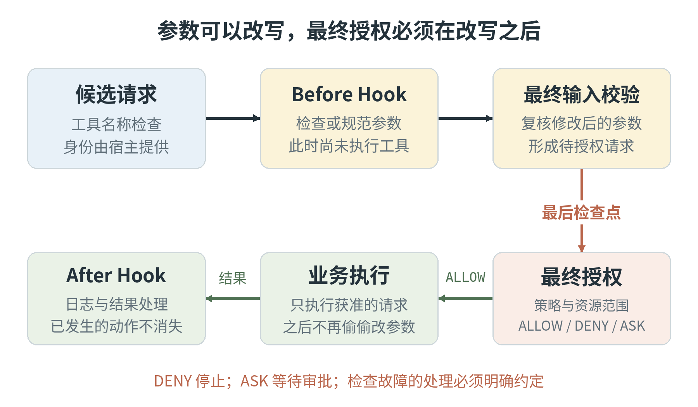
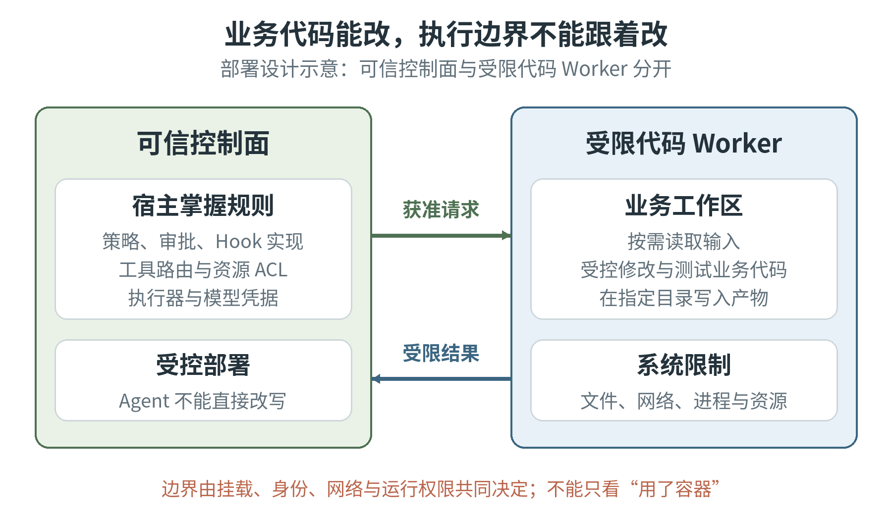

# 04 · Hooks 怎样守住写入前的一步，又怎样解释写入后的错误

P-101 详情页已经出现设备跟进备注，助手却说刚才失败了。如果重新点“追加”，会不会多出第二条？要判断该补写、补审计还是先查回执，必须知道错误发生在业务提交的哪一侧。这一课接着第三篇的审批单，分别跑最小的工具包装、真实的 AgentScope 暂停与恢复，以及 SQLite 上的故障实验。[本课代码](code.py) · [上一课的批准规则](../s03_permissions/README.md)

## 一、Hook 挂在哪一步，能改变什么

**Hook（钩子）**是宿主在已定义的生命周期位置调用的一段代码。设计一个 Hook 时，要说清它何时收到什么、能否阻止下一步、它自己报错时业务是否已经发生。



沿第三篇的图从候选请求往下读。工具若允许先改写参数，最后要对**实际进入执行器的参数**校验和授权。把“禁止写这个项目”放在业务提交之后，Hook 能做的是识别事件、记录问题或启动更正，先前已经提交的备注仍需要在台账中处理。

| 放置位置 | 可做的检查或动作 | 要去哪里验证 |
| --- | --- | --- |
| 模型调用前 | 核对当前身份，准备允许送入模型的上下文 | 查看传入消息中的字段、来源和身份范围 |
| 工具执行前 | 消耗预算、比较待办与实参、拒绝执行 | 看执行器是否进入、业务表是否为空 |
| 工具执行后 | 记录结果、计时或补审计 | 分开读业务记录和审计记录 |
| 确认后恢复时 | 重新取得授权，定位原回复、原调用与原待办 | 对照调用编号、批准编号与最终提交对象 |

## 二、先用一次读取看清前后顺序

[源码 · 不同退出点能经过哪些 Hook](code.py#L26-L37)

```python
def with_hooks(execute, before, after):
    def dispatch(call):
        before(call)
        try:
            result = execute(call)
        except Exception:
            after(call, "error")
            raise
        after(call, "end")
        return result

    return dispatch
```

`before(call)` 放在 `try` 之前。预算用完时，异常直接返回给循环，业务读取没有开始。进入 `execute` 后读取不存在的段号，则会先产生 `start`，再进入 `except` 产生 `error`。正常读到 R2 时才走 `end`。这段小包装让我们只看控制流，下一节再看 SDK 如何接上回调。

```sh
uv run --no-sync python -m tutorials.s04_hooks.code
uv run --no-sync python -m tutorials.s04_hooks.code --budget 0
uv run --no-sync python -m tutorials.s04_hooks.code --section R9
```

三条命令都能看到第一课的 `Call(id='read-1', …)`。默认路径还能找到 `read-1 start`、`read-1 end` 和带 R2 的 `Result`。预算为零时只看见模型请求与拒绝原因。R9 则留下 `start → error`。如果要统计“模型提过多少次”和“业务函数执行了多少次”，应当从两个不同的观察点计数。[预算与事件输出](code.py#L40-L58)

## 三、让真实的 AgentScope 暂停和恢复

本节的模型返回固定的 `append_note` 请求，AgentScope 2.0.10 的权限判断、事件流、恢复以及本机数据库写入都实际执行。第三篇描述了 2.0.12 的实验，这里的事件顺序来自仓库锁定版本的独立复跑。[教学模型](code.py#L117-L124) · [工具声明与中间件挂载](code.py#L184-L204)

[源码 · 取得框架原决定，再检查当前项目](code.py#L136-L150)

```python
async def on_check_permission(self, agent, input_kwargs, next_handler):
    framework = await next_handler(**input_kwargs)
    call = input_kwargs["tool_call"]
    project = input_kwargs["tool_input"]["project"]
    local = decision(OWNER, self.grants, project, call.name)
    print("权限检查", framework.behavior.value, local)
    if local == "DENY":
        return PermissionDecision(behavior=PermissionBehavior.DENY, message="项目权限已收回。")
    if (
        local == "ASK"
        and framework.behavior == PermissionBehavior.ALLOW
        and call.state != ToolCallState.ALLOWED
    ):
        return PermissionDecision(behavior=PermissionBehavior.ASK, message="项目要求核对本次备注。")
    return framework
```

对于**首次提出的调用**，可以用九种组合读懂这段代码。先选框架所在的行，再选项目所在的列。任何一方拒绝都会结束执行。两边都允许时可以继续。其余情况都要先问人。

| 框架决定 | 项目允许 | 项目要求确认 | 项目拒绝 |
| --- | --- | --- | --- |
| 允许 | 允许 | 等待确认 | 拒绝 |
| 要求确认 | 等待确认 | 等待确认 | 拒绝 |
| 拒绝 | 拒绝 | 拒绝 | 拒绝 |

默认实验落在正中间的格子。`sdk_demo` 捕获 `RequireUserConfirmEvent`，取得原始工具调用，把规范化的项目和正文保存为第三课的待办，此刻台账仍为空。一轮实验只处理一项待确认调用，`reply_id` 指整次回复，`call.id` 指这一次工具调用，两者分别从等待事件取回。

[源码 · 把一次审核送回原回复与原调用](code.py#L225-L235)

```python
print("待审原文", gate.item.note.project, gate.item.note.text)
print("等待时台账", db.execute("SELECT count(*) FROM notes").fetchone()[0], "条")
if case != "unrecorded":
    gate.approved_ids.add(gate.item.operation_id)
if case == "revoked":
    gate.grants.clear()
confirmation = ConfirmResult(tool_call=call, confirmed=True, rules=None)
resume = UserConfirmResultEvent(reply_id=waiting.reply_id, confirm_results=[confirmation])
async with aclosing(agent.reply_stream(resume)) as stream:
    async for _ in stream:
        pass
```

这里的 `approved_ids` 是宿主侧模拟的人工审批记录。原回复编号和 `tool_call=call` 把结果送回正在等待的调用，`rules=None` 表示这次点击没有新增长期规则。恢复时 SDK 再次经过权限中间件，此时框架会对已确认的调用给出 `allow`。代码用 `call.state` 区分初次请求与确认后的恢复，以免让人反复确认同一份原稿。项目的即时拒绝仍然先于这项判断。之后的 `on_acting` 还会复核调用 ID、实际参数和宿主批准记录。全部通过才交给写工具。[执行前的最终复核](code.py#L152-L174)

```sh
uv run --no-sync python -m tutorials.s04_hooks.code --sdk approve
uv run --no-sync python -m tutorials.s04_hooks.code --sdk revoked
uv run --no-sync python -m tutorials.s04_hooks.code --sdk unrecorded
uv run --no-sync python -m tutorials.s04_hooks.code --sdk project-ask
uv run --no-sync python -m tutorials.s04_hooks.code --sdk framework-deny
```

| 输入 | 框架与项目各看到什么 | 查 SQLite 台账 |
| --- | --- | --- |
| 允许这份原稿 | `allow ASK`，执行入口找到已批准的原文 | 1 条，P-101，正文仍是 A17、A18 |
| 等候期间收回项目 | `allow DENY`，项目规则结束该次调用 | 0 条 |
| 只有框架确认事件 | `allow ASK`，执行入口给出 `not_approved` | 0 条 |
| 工具允许，但项目要求确认 | 首次是 `allow ASK`，仍会停下来展示原文，恢复后再查批准记录 | 等待时 0 条，恢复后 1 条 |
| 工具已被框架拒绝 | 首次是 `deny ASK`，没有待确认事件 | 0 条 |

注意第二行。第一次检查和第二次检查使用的是同一个调用 ID，却可以有不同决定，因为真实世界里的项目已经移交了。工作台的 `TurnMiddleware` 也会在每次模型和工具调用前重验权限。本章用于教学的 `ReviewGate` 专门演示共享备注的人工批准。[工作台的工具中间件](../../src/biu_agent/agents/hooks/__init__.py#L60-L76)

## 四、实战，把故障分别放在提交的两侧

[源码 · 让同一条调用在提交前或提交后中断](code.py#L83-L89)

```python
def deliver_note(db, key, note, fault):
    if fault == "before":
        raise Problem(409, "precheck_failed", "前置检查失败，执行器未启动")
    receipt = append_once(db, key, note)
    if fault == "timeout":
        raise TimeoutError("调用方未收到响应，结果待确认")
    return receipt
```

`deliver_note` 收到的是一份已批准的固定样本。`before` 在进入写函数前抛错。`timeout` 先让 SQLite 事务提交，再从调用方能收到回执的位置抛出超时。`after` 在业务写完之后单独让审计抛错。这样三次实验的业务条件相同，差异来自故障位置。

[源码 · 同一操作编号只接受相同的业务内容](code.py#L66-L75)

```python
def append_once(db, operation_id, note):
    with db:
        db.execute(
            "INSERT INTO notes VALUES(?,?,?) ON CONFLICT(operation_id) DO NOTHING",
            (operation_id, note.project, note.text),
        )
        row = db.execute("SELECT project,body FROM notes WHERE operation_id=?", (operation_id,)).fetchone()
        if row != (note.project, note.text):
            raise Problem(409, "operation_conflict", "同一操作编号已经用于不同的备注。")
    return row
```

`operation_id` 是业务表主键。相同编号重放时先保留已存在的行，然后比较项目和正文。如果同一个编号被拿来写另一段内容，会返回 `operation_conflict`。确认单的一次性消费解决“谁批准过”，业务表的唯一键解决“这个操作有没有提交过”，两处使用的证据不同。

```sh
uv run --no-sync python -m tutorials.s04_hooks.code --fault before
uv run --no-sync python -m tutorials.s04_hooks.code --fault after
uv run --no-sync python -m tutorials.s04_hooks.code --fault timeout
```

| 注入的故障 | 终端中要找哪一行 | 恢复动作与最终台账 |
| --- | --- | --- |
| 提交前拒绝 | `前置检查失败，执行器未启动` | 当次没有业务写入，台账 0 条 |
| 后置审计出错 | `已写入，审计待补 0`，随后审计表有 `note-1` | 只补同一操作的审计，台账 1 条 |
| 提交后回执丢失 | `调用方未收到响应，结果待确认`，随后查到 P-101 原文 | 按原操作号查询，台账 1 条 |

练习时先遮住“台账回读”。假如只看到 `TimeoutError`，能判定写了几条吗？只有当操作号对应的记录查询返回，才能决定下一步。本例有意注入“已经提交”的超时。如果真实服务还没有可查询的回执，应保留“结果待确认”，直到能从业务端对账。[故障恢复与审计回读](code.py#L92-L114) · [工作台对不确定写入的处理](../../src/biu_agent/actions.py#L109-L126)

如果需求改成“先写，再给负责人审”，先问清未审内容谁能看见。一种做法是把第一次写入保存为仅提交人可见的草稿，再让获准的发布动作把指定版本放入共享台账。已经对同事可见的备注需要按更正规则处理。第二课的待发队列提供了一个可对照的批准后入队实验。[02 · 批准、重提与回读](../s02_tools/README.md)

## 五、谁能修改正在生效的 Hook



沿着第三篇这张图的两支箭头看。宿主保存生效的策略、批准记录和凭据，工作进程拿到本次允许处理的输入，返回受约束的结果。假如助手能够直接改动宿主正在用的批准表或 Hook 源码，应用层每次调用前的比较就失去了可信基准。实际部署时，应分别验证工作进程能读哪些输入、能写哪些输出，以及策略与凭据由谁保存。本课的两个角色在同一个 Python 进程里演示控制顺序，操作系统隔离需要在部署环境单独验收。

## 六、总结与自检

对着一条失败日志，依次还原三个时刻。模型提出请求时记录的是什么？权限检查结束时业务函数是否已经进入？最后台账和审计表各有几条？当这三个问题可以分别从代码和输出得到答案，才知道“再试一次”会补齐什么。下一课用相同的方法区分“看到了技能目录”“读了技能说明”和“真的取得了材料”。[05 · Skills 加载](../s05_skill_loading/README.md) · [课程目录](../README.md)
