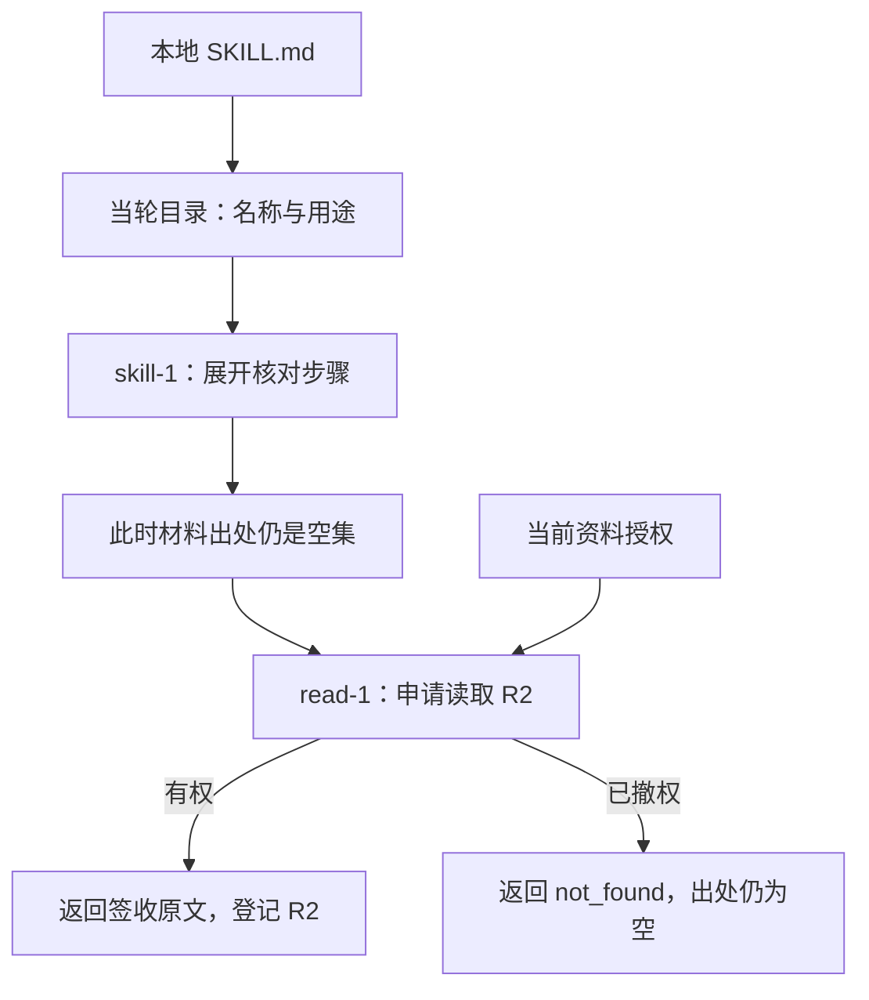

# 05 · Skills 加载，一份操作说明怎样进入模型上下文

展具组已经写好一页《材料核对》。里面规定先查到货记录，再对验收说明，回答要带段号。把这页说明交给助手之后，它能马上回答“导向牌验收通过了吗”？先猜一猜，只读完说明，本轮应该登记几条材料出处？运行到最后你会看到，即使技能加载成功，结果仍可以是零。[本课代码](code.py) · [实验中的 SKILL.md](../../src/biu_agent/agents/skills/source-review/SKILL.md)

## 一、一个 Skill 包含什么

**Skill 是一份供 Agent 在适用任务中加载的操作说明。** 本例的文件头给出 `name=source-review` 和 `description`，正文才写核对材料的先后顺序。名称让程序稳定寻址，描述让模型判断何时值得加载，正文指导加载之后怎样工作。Agent Skills 格式还允许附带脚本、参考资料和资产。本章可以只靠一份 `SKILL.md` 完成。[Agent Skills 格式规范](https://agentskills.io/specification)

| 在哪一步观察 | 本例能看到什么 | 学这一层要回答的问题 |
| --- | --- | --- |
| 宿主发现文件 | 本地已安装的说明及其正文 | 这份资源在哪里，能否解析？ |
| 构造当轮目录 | `source-review` 及用途，另有可调用的 `Skill` 工具 | 当前智能体可以选择哪些方法？ |
| 调用 `Skill` | 正文里出现“先看目录”等具体步骤 | 模型下一轮能按哪套步骤操作？ |
| 再调用 `read_material` | 授权原文、版本和 `receiving#R2` | 哪项业务事实已经取到证据？ |

“按需加载”在这里有两个观察位置。宿主为了建立目录可以先读取文件。模型只在收到展开的正文后才占用这部分输入。研究上下文开销时，应检查发给模型的消息。单凭文件已在宿主内存中，推不出模型已经看过它。



图中画的是已加载技能的一次查询。沿着 `skill-1` 往下读，到 `read-1` 时把当前资料授权也考虑进来。技能说明可以教会助手下一步该查哪份资料，能否取得那一段原文则要等到第二次工具调用。本章最后两条回执可以逐个对应到图中。

## 二、从文件或账号配置构造同一份目录

[源码 · 文件加载与账号绑定的两条入口](code.py#L18-L24)

```python
def load_skills(folder, binding):
    if binding == "file":
        return [LocalSkillLoader(str(folder))]
    slug, row = unpack(folder.joinpath("SKILL.md").read_text(encoding="utf-8"))
    row.update(revision=1, enabled=binding != "disabled")
    selected = [] if binding == "unbound" else [slug]
    return bind({slug: row}, selected)
```

默认路径把本地目录交给 AgentScope 的 `LocalSkillLoader`。`--binding enabled` 则走工作台的做法，用 `unpack` 解析同一个文件，给它一个练习版本，交给 `bind` 构造 SDK 的技能对象。运行前可以把账号启用的技能和智能体选中的技能分别列一遍。进入这一轮的是两者共同包含的成员。`disabled` 从前者移除，`unbound` 从后者移除。[工作台解析与绑定](../../src/biu_agent/agents/skills/__init__.py#L14-L40) · [装配时的筛选](../../src/biu_agent/agents/skills/__init__.py#L67-L72)

[源码 · 先读目录及工具声明，再用名称取正文](code.py#L51-L63)

```python
toolkit = Toolkit(
    skills_or_loaders=load_skills(folder, binding),
    skill_instruction_template=template,
    tools=[tool(read_material, Passage, "按当前账号读取原文。", on_result=record)] if verify else [],
)
state = AgentState()
catalog = await toolkit.get_skill_instructions()
schemas = await toolkit.get_tool_schemas()
print("初始技能目录", catalog or "（空）")
print("本轮工具", [schema["function"]["name"] for schema in schemas])
if catalog:
    result = await invoke(toolkit, state, "skill-1", "Skill", {"skill": name})
    print("取回正文", result.state.value, result.content[0].text)
```

`get_skill_instructions()` 按模板生成目录。`get_tool_schemas()` 返回模型可见的可调用工具。随后 `invoke` 用 `skill-1` 标识一次真正的 SDK 请求，并只取工具的终态回执。这里由脚本指定名称，所以能稳定比较目录与正文。自由模型会选择哪项技能，是另一项需要实测的问题。[调用和终态回执](code.py#L27-L32)

## 三、实战，改变目录、名称与绑定

在仓库根目录执行。默认命令中先找“初始技能目录”，再向下翻到“取回正文”。只有后者包含“对采购、到货、验收分别核对”的步骤。

```sh
uv run --no-sync python -m tutorials.s05_skill_loading.code
uv run --no-sync python -m tutorials.s05_skill_loading.code --brief
uv run --no-sync python -m tutorials.s05_skill_loading.code --name missing
uv run --no-sync python -m tutorials.s05_skill_loading.code --binding unbound
```

| 改动 | 目录与工具 | 展开结果 |
| --- | --- | --- |
| 默认文件 | 目录有名称及用途，工具有 `Skill` | 成功取回全文，出处仍为 `[]` |
| `--brief` 仅给名称 | 目录变短，`Skill` 仍可用 | 用相同名称能取回同一篇全文 |
| `--name missing` | 目录仍有 `source-review` | 终态为 `error`，含 `SkillNotFoundError` |
| `--binding unbound` | 本轮目录为空，工具列表为空 | 程序没有发起展开请求 |

如果只看到一个工具叫 `Skill`，应该向它传哪个名字？在初始目录找 `source-review`。把“目录条目的名字”和“用于展开的工具名”写成两列，就能诊断“装上了但调用时找不到”的两种原因。发错名字时有一条失败的回执，目录为空时连这次调用都不会发生。

## 四、把技能加载和资料授权放进同一次实验

[源码 · 原文授权与成功登记的出处](code.py#L36-L44)

```python
folder = files("biu_agent.agents").joinpath("skills", "source-review")
evidence = []
grants = {"receiving"} if verify == "granted" else set()

async def read_material(id, section):
    return excerpt(id, section, grants)

def record(row):
    evidence.append(row["source"])
```

`grants` 是宿主给资料工具的可读范围。`record` 只有在工具包装器验证输出成功后才被调用。`Skill` 读取的是操作说明，没有向这个列表登记任何段落。文件正文里的 `[文件ID#段号]` 是写作约定，只有实际读出的 `receiving#R2` 能作为本轮证据。

```sh
uv run --no-sync python -m tutorials.s05_skill_loading.code --binding enabled --verify granted
uv run --no-sync python -m tutorials.s05_skill_loading.code --binding enabled --verify revoked
uv run --no-sync python -m tutorials.s05_skill_loading.code --binding disabled --verify granted
```

在第一条命令里圈出 `skill-1` 和 `read-1` 在源码中的位置。前一次读取后控制台打印 `读说明后的出处 []`，后一次读取才登记 `['receiving#R2']`。第二条只收回资料范围，说明依然取回成功，读取 R2 返回 `error` 和 `not_found`。第三条只停用技能，目录显示“空”，终端仍然能通过已绑定的资料工具拿到 R2。[两次调用的观测位置](code.py#L61-L68)

**迁移到工作台。** 在“技能”页导入或启用说明，再到目标智能体勾选它。检查本轮工具中是否有读取材料的能力。遇到“助手熟悉规范，却交不出原文”时，先看资料调用的回执，再决定是资料授权、工具绑定或技能说明需要调整。[工作台装配](../../examples/tickets/workspace.py#L150-L165) · [材料工作台练习](../00-material-workspace/README.md)

## 五、总结与自检

拿一段操作说明做一次双向验证。收回资料权限后，助手仍能复述哪些步骤？保留资料权限但移除技能绑定后，脚本还能取得哪条事实？能用两份回执和一个出处解释两次结果，就知道把长期流程写在何处，以及把事实检查留给哪个工具。下一课会问，上一轮曾读过的原文能否直接进入这一轮答复。[06 · 上下文工程](../s06_context/README.md) · [课程目录](../README.md)
