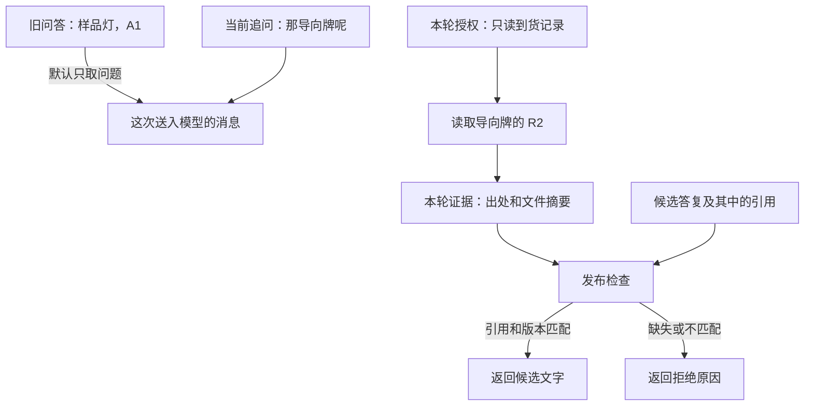

# 06 · 上下文工程，追问里要带多少历史，回答里能用哪些证据

小舟先问“样品灯验收了吗”，助手回答“已通过”并引用 A1。接着他问“那导向牌呢？”删掉历史，“那”失去了参照。把上轮答复当成本轮依据，又容易把样品灯的验收结果误套到导向牌上。本实验固定第二问，分别观察模型输入、本轮实读、候选文字和发布结果。[本课代码](code.py) · [到货原文](../../examples/tickets/data/receiving.md) · [验收原文](../../examples/tickets/data/acceptance.md)

## 一、上下文工程要做哪些选择

**上下文工程**指宿主为一次模型决策选择、组织和更新输入的过程。模型可以接收任务、工具声明、历史消息、技能说明和工具回执。对每一项，都可以追问它帮助当前哪项判断、当前身份是否可见，以及它占了多少输入空间。

| 这轮的材料 | 进入什么位置 | 能支持的判断 |
| --- | --- | --- |
| 旧问题“样品灯验收了吗” | 一条标明“先前问题”的消息 | 当前追问承接验收话题 |
| 旧回答及 A1 | 留在会话历史中，默认材料模式只投影问题 | 可回看先前交互，不能自动成为本轮取得的依据 |
| 当前问题和获准的到货记录 | 用户消息及本轮 `excerpt` | R2 明确说导向牌已签收、待安排检查 |
| 本轮出处与文件摘要 | `ctx.evidence`，交给发布检查 | 核对引用有没有实读、材料版本有没有改变 |

这里讨论的是取舍。增加上下文可能补足指代，也可能把旧版本、其他对象的结论或当前无权读取的信息重新带回来。工作台把历史问题用来解释用户意图，再按当轮权限读取资料。下面的 `--history full` 供观察另外一种投影，在真实业务中还要按可见范围挑选历史内容。



从旧答案里的 A1 出发，图上没有一条边能把它登记为本轮证据。反过来，沿着 R2 通过发布检查的路径走，最后的文字就一定解释对了原文吗？第三节会用一条能通过检查的错误结论来回答。

## 二、先看组装好的消息，再看本轮取证

[源码 · 旧问答与本轮授权如何进入同一个 TurnContext](code.py#L18-L29)

```python
def material_turn():
    ctx = TurnContext(
        principal=Principal("展具组", "小舟", "1", ""),
        session_id="练习会话",
        turn_id="第二问",
        input_text="那导向牌呢？",
        previous_display=None,
        visible_set_id=None,
        history=[("样品灯验收了吗？", "样品灯验收通过。[acceptance#A1]")],
    )
    ctx.profile["sources"] = {"receiving"}
    return ctx
```

`history` 明确含旧答案和 A1，`profile["sources"]` 却只允许本轮读到货记录。`messages_for` 在材料模式下取每对历史问答的第一个元素，与当前问题编码进一条用户消息。把 `questions_only` 改为假会恢复交替的 user、assistant 消息。本章打印组装后的消息并用固定候选文字复验发布过程，整个实验无需模型服务。[模型消息的实际装配](../../src/biu_agent/agents/context/__init__.py#L8-L16)

[源码 · 消息投影、本轮读取与候选答案](code.py#L32-L42)

```python
def main(workspace, case, history):
    ctx = material_turn()
    if history == "empty":
        ctx.history.clear()
    for msg in messages_for(ctx, questions_only=history != "full"):
        print("本轮模型输入", msg.role, msg.get_text_content())
    row = excerpt("receiving", "R2", ctx.profile["sources"])
    ctx.evidence[row["source"]] = row.copy()
    ref = "acceptance#A1" if case == "reuse" else row["source"]
    claim = "导向牌已通过验收。" if case == "wrong-claim" else row["text"]
    candidate = claim if case == "no-citation" else f"{claim} [{ref}]"
```

运行以下三次，先只读前几行输出。哪一次还能在“本轮模型输入”找到 A1？哪一次只剩下当前问题？三次都从同一份授权源读取 R2，因此即使消息长度不同，候选答案可使用的实读出处仍然相同。

```sh
uv run --no-sync python -m tutorials.s06_context.code
uv run --no-sync python -m tutorials.s06_context.code --history full
uv run --no-sync python -m tutorials.s06_context.code --history empty
```

默认消息中的 JSON 用“先前问题”和“当前问题”区分用途。`full` 的第二条是含 A1 的旧 assistant 消息，`empty` 只剩“那导向牌呢？”。用这三份输入可以评估上下文里有哪些信息。由于本实验的选段由脚本确定，不能把三次相同的 R2 归因于自由模型理解指代的能力。

## 三、实战，让四个看起来相近的答复走发布检查

[源码 · 把候选交给工作台本身的 verify](code.py#L43-L50)

```python
if case == "stale-version":
    # 重现读取旧版后发布的场景，让 verify 与当前磁盘文件重新对账。
    ctx.evidence[row["source"]]["sha256"] = sha256("此前的练习版本".encode()).hexdigest()
print("本轮实读", row["source"], row["text"])
try:
    print("发布", workspace.verify(ctx, candidate))
except Problem as error:
    print("拒绝发布", error.code)
```

`Workspace.verify` 从候选文字中抽取出处，查它们是否属于本轮，然后重新读取证据版本。读过材料却没给引用，也会被拒绝。`--case stale-version` 给本轮登记的证据注入旧摘要，磁盘上的虚构资料保持原样。这样同学之间可以稳定复现版本不一致。[出处、版本与缺失引用的判定](../../examples/tickets/workspace.py#L191-L209)

```sh
uv run --no-sync python -m tutorials.s06_context.code --reuse-citation
uv run --no-sync python -m tutorials.s06_context.code --case no-citation
uv run --no-sync python -m tutorials.s06_context.code --case stale-version
uv run --no-sync python -m tutorials.s06_context.code --case wrong-claim
```

| 输入 | 发布结果 | 用哪项事实解释 |
| --- | --- | --- |
| 读了 R2，却引用旧 A1 | `unverified_source` | 这一轮登记的集合里没有 A1 |
| 答对签收情况，但删掉引用 | `missing_citation` | 读者无法从答案回查刚才用的段落 |
| 登记的文件摘要已过期 | `source_changed` | 出处名相同，对应的文件版本不一致 |
| 写“导向牌已通过验收”，仍引用真实 R2 | 会输出这条错误结论 | 定位符与摘要都匹配。原文写的是“待安排检查”，语义支持还需另行判断 |

最后一行是一个值得保留的反例。让读者先看引用能否打开，再念出原文。若你的业务要求“所有结论都有充分依据”，除了对定位符做程序校验，还要在评测中检查“原文是否推出这句话”。这个例子可直接作为一个应判错的样本。

## 四、八个历史问题遇到六轮上限，会留下哪几轮

真实对话还会遇到重生成、失败修订和输入预算。`history_window` 建了一张只包含产品查询所需列的临时 SQLite 表。问题 1 到 7 首先成功，随后问题 4 有一次成功修订、问题 5 有一次失败修订，再插入问题 8。问题 6 的旧回答故意设为 12,001 个字符。[样本时序](code.py#L53-L69)

[源码 · 用同一批记录查询三个不同的时间窗口](code.py#L70-L78)

```python
for label, cutoff, only_questions in [
    ("原问题4之前", 4, True),
    ("后来只取问题", 11, True),
    ("后来连同回答", 11, False),
]:
    selected = history_before(db, "demo", cutoff, questions_only=only_questions)
    print(label, [question for question, _ in selected])
    if label == "后来只取问题":
        print("所选回答版本", [answer for q, answer in selected if q in ("问题4", "问题5")])
```

```sh
uv run --no-sync python -m tutorials.s06_context.code --history-window
```

| 查询 | 实际留下什么 | 怎样读这组结果 |
| --- | --- | --- |
| 重建原问题 4 之前的输入 | 问题 1、2、3 | 截点按原提问位置计算，当时看不到未来 |
| 后来只取问题 | 问题 3 到 8 共六项 | 选中问题 4 的成功修订，问题 5 仍用此前成功的原答。装配成消息时才剔除答案 |
| 后来连旧回答一起计入 | 问题 7、8 | 从新向旧扫描，遇到问题 6 的超长回答便停止，返回时再恢复时间顺序 |

这里有两种限制，最多六个问题位置，以及 12,000 **字符**。这个数字是历史投影的局部预算，无法从它推出完整模型请求的 token 数。若把上限改大，应该先检查多进来的资料是否仍然可信、是否真的帮助理解追问。[产品的历史选择与预算](../../src/biu_agent/agents/memory/__init__.py#L34-L46)

## 五、总结与自检

遇到“助手记错了”的报告，先保存那一轮实际组装的消息，再看本轮读取了哪些出处。若对象指代错了，查消息选择。复用了旧引用时查证据登记。引用真实而结论错误时，把结论与原文一起交给评测。下一课把生命周期再拉长，检验用户换了会话以后哪类信息应该保留。[07 · 记忆系统](../s07_memory/README.md) · [课程目录](../README.md)
