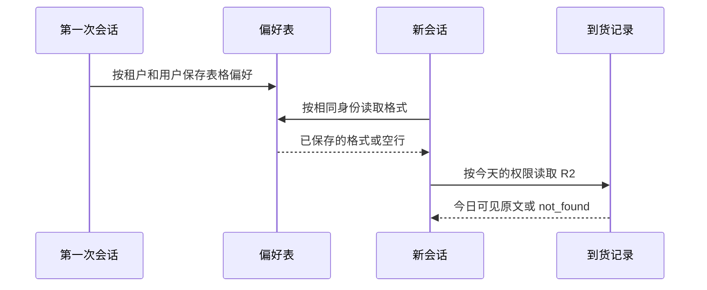

# 07 · 记忆系统，新会话怎样记住格式，又能忘掉它

“这次用表格列出处”和“以后都用表格列出处”只差两个字。今天的答复可以一样，明天新开对话时应该不同。再把实验改一个条件。小舟的格式偏好还留着，但他今天已经不能读到货记录，助手能输出什么？本课用一个临时 SQLite 文件和三个依次打开的连接，把写入、修改、遗忘和新会话读取分开观察。[本课代码](code.py)

## 一、给记忆定义所有者与有效期

**跨会话记忆**是宿主在一次交互结束后仍保存、以后按条件召回的信息。本例只保存用户明确要求保留的回答格式。是否“记住”可以通过独立读连接查到的数据来验证。把所有历史消息一次次拼进提示词，无法回答“用户要求忘记后哪一行应被删除”。

| 用户说了什么 | 涉及的数据与生命周期 | 本课怎样处理 |
| --- | --- | --- |
| “那导向牌呢？” | 上轮问题，随当前会话及其授权读取 | 由上一课的历史投影恢复指代 |
| “以后用表格给出处” | 个人格式偏好，可跨会话覆盖或删除 | 存入 `preferences` |
| “导向牌已签收” | 会更新的业务事实 | 新会话按当下权限重新读取 R2 |
| “我们组已批准发周报” | 涉及对象、版本和批准人的业务决定 | 需要回查业务审批记录，个人偏好表没有这项权力 |

这也是工作台已有能力与本课扩展的边界。工作台能恢复已有会话里的问题和修订。本章单独实现用户偏好表，让“新会话记得什么”有一条可以实测的路径。[工作台的历史读法](../../src/biu_agent/agents/memory/__init__.py#L34-L46)

## 二、从数据库键读出谁能看见这条偏好

[源码 · 用同一个所有者键写入、覆盖和删除](code.py#L17-L26)

```python
def remember(db, actor, layout):
    db.execute(
        """INSERT INTO preferences(tenant, owner, layout) VALUES (?, ?, ?)
           ON CONFLICT(tenant,owner) DO UPDATE SET layout=excluded.layout""",
        (actor.tenant_id, actor.user_id, layout),
    )


def forget(db, actor):
    db.execute("DELETE FROM preferences WHERE tenant=? AND owner=?", (actor.tenant_id, actor.user_id))
```

同一租户里，小舟是 `u-7`，青禾是 `u-8`。另一个租户也有自己叫 `u-7` 的账号。主键因此包含 `tenant` 和 `owner` 两列。显示名只用于打印。若今后改昵称，只要认证身份的稳定标识相同，仍会召回原设置。实验用固定的 `Principal` 代表已登录身份，业务系统应从宿主取这个值。[三种练习身份](code.py#L12-L14)

`ON CONFLICT` 让再次指定格式只更新原行。若用户从表格改成段落，新会话不会同时读到两条互相矛盾的偏好。删除也使用相同的复合键，否则“删除我的偏好”可能影响另一个租户的同号账号。[SQLite 对 UPSERT 的定义](https://sqlite.org/lang_upsert.html)

[源码 · 跨三个独立连接重现保存、更新和忘记](code.py#L43-L55)

```python
def main(path, args):
    with closing(sqlite3.connect(path)) as db, db:
        db.execute("""CREATE TABLE preferences(tenant TEXT NOT NULL, owner TEXT NOT NULL,
                   layout TEXT NOT NULL CHECK(layout IN ('段落', '表格')), PRIMARY KEY(tenant,owner))""")
        if not args.once:
            remember(db, XIAO, "表格")
        if args.isolation:
            remember(db, OTHER, "段落")
    with closing(sqlite3.connect(path)) as db, db:
        if args.update:
            remember(db, XIAO, "段落")
        if args.forget:
            forget(db, XIAO)
```

第一段提交后关闭连接。第二段打开同一个文件，按本次指令更新或删除。第三段才打印偏好表并模拟新会话答复。内存中的旧消息从未传给 `answer`。每次重新执行命令都会创建一个新的临时文件，因此不同实验可以从相同初始条件出发。[新连接中的回读](code.py#L56-L64)



沿两次读取分别追问。中间删除偏好，会改变偏好表的返回值。中间收回资料权限，会改变到货记录的返回值。它们分别解释了新会话用什么格式，以及这个账号今天还能看到什么。

## 三、实战，区分临时要求、长期偏好和已删除记录

```sh
uv run --no-sync python -m tutorials.s07_memory.code
uv run --no-sync python -m tutorials.s07_memory.code --once
uv run --no-sync python -m tutorials.s07_memory.code --update
uv run --no-sync python -m tutorials.s07_memory.code --forget
```

| 输入 | 新连接查到的行 | 新一轮的答复 |
| --- | --- | --- |
| 默认，明确要求以后用表格 | 展具组、u-7、表格 | 小舟用表格，青禾用默认段落 |
| `--once`，只提出当次格式需求 | 空表 | 新对话里两人都用默认段落 |
| `--update`，之后改成段落 | 展具组、u-7、段落，只有一行 | 两人都用段落，小舟有明确设置 |
| `--forget` | 空表 | 两人也都用段落，小舟的回答来自回退值 |

只比较最后的答复，`--update` 和 `--forget` 看起来完全相同。要证明删除真的生效，请读第一行“偏好表回读”。对于范围更广的记忆系统，若还保存了索引、摘要或缓存，也要分别核对这些保存位置。这个实验只写一张表。

## 四、格式、事实和权限各自决定了什么

[源码 · 先召回格式，再按本轮授权取得事实](code.py#L29-L40)

```python
def answer(db, actor, grants):
    preference = db.execute(
        "SELECT layout FROM preferences WHERE tenant=? AND owner=?", (actor.tenant_id, actor.user_id)
    ).fetchone()
    layout = preference[0] if preference else "段落"
    try:
        row = excerpt("receiving", "R2", grants)
    except Problem as error:
        return f"当前格式 {layout}，原文不可读 {error.code}"
    if layout == "表格":
        return f"| 出处 | 原文 |\n| --- | --- |\n| {row['source']} | {row['text']} |"
    return f"{row['text']} [{row['source']}]"
```

`preference` 决定如何排版。`grants` 决定能否读取 R2。尝试绘制一份表格之前，程序先调用 `excerpt`。如果当前没有读取权，连表格正文都无法生成，所以终端只报告召回的格式和 `not_found`。这避免把昨天读过的材料内容附在今天的偏好上。

```sh
uv run --no-sync python -m tutorials.s07_memory.code --isolation
uv run --no-sync python -m tutorials.s07_memory.code --isolation --forget
uv run --no-sync python -m tutorials.s07_memory.code --revoked
```

第一条命令应该看见两个租户各有一条记录，两个 `u-7` 选择不同。第二条只删除展具组的小舟，实际剩下 `[('灯光组', 'u-7', '段落')]`。第三条的小舟仍会显示“当前格式 表格”，原文返回 `not_found`，青禾则能读 R2。表格偏好没有携带新的资料授权。

**带着一个变更做验收。** 如果以后再加“引用放在行尾”的个人偏好，先写出它是独立字段还是同一格式的另一种取值。然后分别预测修改一项、忘记一项、同号异租户重开会话时要留下哪些行。表结构能否表达这些结果，比一次演示回答用了哪种排版更重要。

## 五、总结与自检

调试“助手怎么还记得”时，可以从新对话使用的读取键追到记录所属的身份，再回看用户当时是否要求长期保存。测试删除时，数据库和答复都值得核对。若记住的是会变动的业务事实，把读取位置改回权威来源，再按本轮权限重查。下一课把触发者从用户换成时钟，继续用数据库回答“到底执行了几次”。[08 · cron 调度](../s08_cron/README.md) · [课程目录](../README.md)
