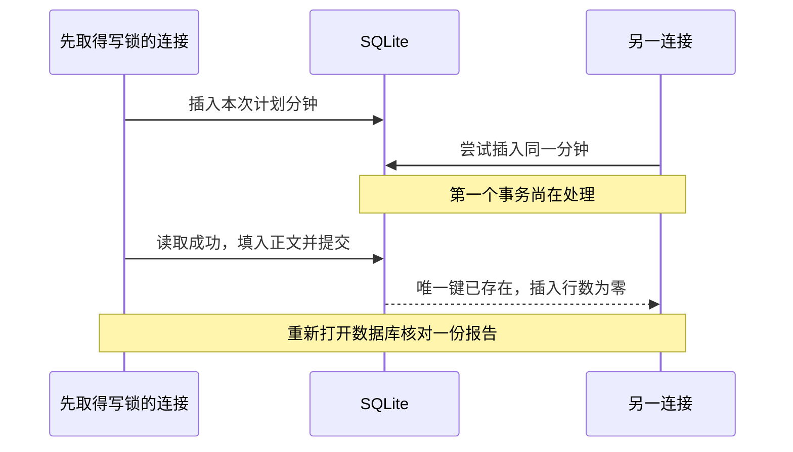

# 08 · cron 调度，同一天的九点该产生几份报告

展具组要每天早上九点核对一次导向牌签收情况。有一天，两个运行实例几乎同时收到九点信号。又有一天，第一次信号到了，资料读取却失败了。过早把这次计划记作完成，会丢掉本该重试的报告。两个实例各写各的，又可能在同一天产生两份。本课用固定时钟和真实的 SQLite 事务重现这两种情况。[本课代码](code.py)

## 一、区分计划、触发信号和业务完成

**cron 表达式**描述哪些日历时刻符合计划。**调度器**按时产生触发信号。**执行器**拿到信号后负责完成工作。这里用数组或两个线程提供信号，执行器仍然调用第一课的循环，实际读取 R2 并写报告。仓库没有因运行本课而安装常驻定时任务。

| 对象 | 本例中的值 | 为什么需要区分 |
| --- | --- | --- |
| 计划 | `0 9 * * *`，业务时区 `Asia/Shanghai` | 一条计划会对应很多天的九点 |
| 本次计划分钟 | `2032-05-18T09:00+08:00` | 同一天的重复信号应得到相同值，隔天会变化 |
| 业务操作 | “签收核对”与本次计划分钟 | 其他任务也可能在这个分钟执行 |
| 完成记录 | `reports` 对应行里的 `body` | 打印过“开始”还不足以交付报告 |

[源码 · 读出每天固定时、分的 cron 子集](code.py#L30-L37)

```python
def daily_time(expression):
    match expression.split():
        case [minute, hour, "*", "*", "*"] if (
            minute.isascii() and hour.isascii() and minute.isdecimal() and hour.isdecimal()
        ):
            return time(int(hour), int(minute))
        case _:
            raise ValueError("本课支持每日固定时刻，例如 0 9 * * *")
```

五个字段依次是分、时、日、月和星期。教学解析器只支持固定整数分钟和小时，后三格必须为星号。`1 9 * * *` 表示 09:01。区间、步长或指定星期需要扩展解析器。解析使用 `datetime.time` 检查时、分的有效范围。传给 `tick` 的时钟还要带时区，避免让机器本地时区悄悄决定应该属于哪一天。[业务时区与四组时间输入](code.py#L15-L27) · [Python 对时区转换的支持](https://docs.python.org/3.12/library/zoneinfo.html)

## 二、一个事务怎样同时解决重复和失败

[源码 · 抢占计划分钟，读原文，提交报告](code.py#L40-L55)

```python
def tick(db, now, due, read):
    if now.utcoffset() is None:
        raise ValueError("时钟输入需要时区")
    local = now.astimezone(ZONE)
    if local.time().replace(second=0, microsecond=0) != due:
        return "未到触发分钟"
    slot = local.isoformat(timespec="minutes")
    with db:
        claimed = db.execute(
            "INSERT INTO reports(job,slot) VALUES (?,?) ON CONFLICT(job,slot) DO NOTHING", (JOB, slot)
        )
        if not claimed.rowcount:
            return "该分钟已经完成"
        report = run_loop("导向牌签收了吗？", decide_receipt, read, observe=lambda _: None)
        db.execute("UPDATE reports SET body=? WHERE job=? AND slot=?", (report, JOB, slot))
    return report
```

顺序很重要。先统一到业务时区，再取精确到分钟的时间。只有符合计划时，才尝试插入 `(job, slot)`。表上有同样两列的主键，插入成功的连接才会继续执行读取。另一个连接撞到相同的键，`rowcount` 为零，可以直接返回。[报告表的唯一键](code.py#L75-L77)

继续跟到 `with db` 的末尾。占位行与报告正文在同一事务中。如果读取 R2 抛异常，事务会把占位一同回滚，后到的信号仍有机会完成任务。这里让事务覆盖的工作只是一次本地只读操作。如果以后改成耗时较长的远端写入，就要单独处理锁的持有时间、业务操作编号和远端回执。本地回滚无法撤销已经在外部完成的动作。[第四课的写入后恢复](../s04_hooks/README.md)

## 三、实战，把同一组时钟送两遍

```sh
uv run --no-sync python -m tutorials.s08_cron.code
uv run --no-sync python -m tutorials.s08_cron.code --fail-first
uv run --no-sync python -m tutorials.s08_cron.code --schedule '1 9 * * *'
```

默认时钟依次送入 08:59、09:00、09:00、09:01。每次信号重新打开数据库连接，最后再开一次连接核对记录。看完第一条，先预测 `--fail-first` 的第二个九点会显示“完成”还是“已完成”。[虚拟时钟和单次故障注入](code.py#L81-L95)

| 信号 | 默认 | 让第一次到点的读取失败 |
| --- | --- | --- |
| 08:59 | 未到触发分钟 | 未到触发分钟 |
| 第一次 09:00 | 读取 R2，提交一份报告 | 读取抛错，占位事务回滚 |
| 第二次 09:00 | 该分钟已经完成 | 重新取得位置，读取 R2 并提交 |
| 09:01 及最终回读 | 已离开计划分钟，表内 1 行 | 同样只有 1 行，正文含 `[receiving#R2]` |

如果只记录了“尝试过两次”，上表两列看起来十分相似。回滚后实际获得报告的是第二次尝试。最后的 `SELECT slot,body` 能将正文与日期对应起来。把计划改为 09:01，两次九点都不匹配，唯一的一份报告随最后一个信号产生。

## 四、并发、跨日、跨时区和错过触发

[源码 · 两个独立连接同时提交同一个计划分钟](code.py#L62-L72)

```python
def simultaneous(path, due):
    start = Barrier(2)

    def worker():
        with closing(sqlite3.connect(path)) as db:
            start.wait(timeout=5)
            return tick(db, datetime.fromisoformat("2032-05-18T09:00+08:00"), due, read_receipt)

    with ThreadPoolExecutor(max_workers=2) as pool:
        futures = [pool.submit(worker) for _ in range(2)]
        return sorted(future.result() for future in futures)
```

`Barrier(2)` 让两个线程都准备好才开始。每个线程拥有自己的 SQLite 连接，互相看不到对方的 Python 局部变量，争用由数据库约束裁决。排序只为了让演示输出稳定，不代表线程有固定的胜出顺序。



图中先取得锁的连接成功提交。如果它读 R2 时抛错，占位行随事务回滚。此时后一个连接遇到的就是空位。用上一节的 `--fail-first` 可以把这条回滚路径重复跑出来。

```sh
uv run --no-sync python -m tutorials.s08_cron.code --clock concurrent
uv run --no-sync python -m tutorials.s08_cron.code --clock utc
uv run --no-sync python -m tutorials.s08_cron.code --clock next-day
uv run --no-sync python -m tutorials.s08_cron.code --clock missed
```

| 实验 | 预测和核对方法 |
| --- | --- |
| 两个真实连接同时进来 | 返回一个带 R2 的结果、一个“该分钟已经完成”，最终查表 1 行 |
| 01:00 UTC 与 09:00 上海 | 表上出现相同的业务分钟 `09:00+08:00`，两个信号共 1 行 |
| 今天与明天各有一个九点 | 回读两行，正文可以相同，`slot` 的日期不同 |
| 只收到 08:59 和 09:01 | 没有匹配信号，最终是 0 行。本课按收到的分钟执行，不回补遗漏 |

如果团队要求“离线期间错过也要补一份”，就要保存上次成功处理的计划分钟，并明确定义补跑时间范围和数据口径。用补跑时的最新到货记录，和重建昨天九点当时的状态，会得到不同的业务报告。这个决定应由报告用途决定。

## 五、总结与自检

把测试条件换成“同一时刻三次触发，第一次读失败”。在纸上写出每次事务是否能提交、最终键是什么、应该留下哪段正文。对于本课的只读核对，合格的验收依据是同一个键下只查到一份完整报告。下一课会把工具移到另一个服务，看看“进入过远端”又能证明什么。[09 · MCP](../s09_mcp/README.md) · [课程目录](../README.md)
