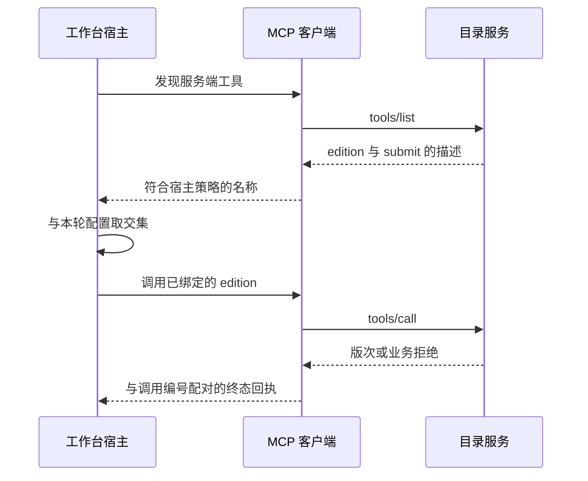

# 09 · MCP，从服务端声明两项工具，到本轮只调用一项

展具目录服务同时提供读取版次和提交目录两项能力。工作台只需要回答“当前材料目录是哪一版”。连接测试显示正常，模型就一定能查到版次吗？本章同时观察服务端清单、宿主筛选、本轮绑定、工具回执和服务端执行次数。这样既能解释“连得上却没有工具”，也能解释“工具确实执行过，用户仍没拿到数据”。[本课代码](code.py)

## 一、协议、宿主策略与远端业务规则

**MCP（Model Context Protocol）**约定宿主通过客户端怎样向服务端发现和调用工具。以工具为例，`tools/list` 取得名称、说明、参数描述等信息，`tools/call` 请求执行具体工具。`readOnlyHint` 等注解是提供者发布的元数据，其可信度取决于服务来源。允许谁使用哪个服务、哪些工具可进本轮、当前身份是否能读某份目录，分别由宿主和业务服务落实。[MCP 工具规范](https://modelcontextprotocol.io/specification/2025-11-25/server/tools)

本例在本机启动真正的 FastMCP 服务，使用 Streamable HTTP 和系统分配的回环端口，命令退出后关闭。AgentScope 客户端与业务端经协议通信。`--remote-deny` 用固定授权开关模拟服务方的业务判断，无需登录真实服务，也无需模型账号。[本机服务的创建与关闭](../../tests/material_server.py#L11-L29)



## 二、谁声明只读，谁能裁决读取

[源码 · 声明两项服务端能力，并记录真正的调用](code.py#L24-L36)

```python
@server.tool(annotations=hint)
def edition() -> str:
    """读取本期材料目录版次。"""
    journal.append("edition")
    if not allow_edition:
        raise ValueError("当前演示身份无权读取目录版次")
    return "春季目录第三版"

@server.tool(annotations=ToolAnnotations(readOnlyHint=False))
def submit() -> str:
    """模拟提交目录。"""
    journal.append("submit")
    return "练习用回执"
```

留意 `journal.append("edition")` 的位置，它出现在权限判断之前。因此服务端执行次数为 1，只能说明请求抵达业务函数。只有随后的授权检查通过，才会返回“春季目录第三版”。`submit` 同样有自己的入口计数，可以验证本地未绑定时是否真的没有发出写工具调用。

[源码 · 原始发现、宿主过滤和本轮绑定](code.py#L41-L48)

```python
async def inspect(url, selected):
    client, names = await discover({"id": "lesson", "url": url}, token=None)
    # 为教学另列一次服务端清单，可与宿主筛选后的名字同时观察。
    descriptions = await client.list_raw_tools()
    print("服务端声明", [entry.name for entry in descriptions])
    print("发现的只读工具", names)
    bound = [name for name in names if name == selected]
    print("绑定到本轮", bound)
```

`discover` 是工作台实际使用的函数。它只接受名称符合本项目规则、明确声明只读、没有破坏性提示的候选项。接着 `bound` 再取一次与当前选择的交集。为了让读者看到被过滤掉的 `submit`，教学脚本额外调用一次 `list_raw_tools()` 打印原始描述。这些发现请求都没有进入上述两个业务函数。[工作台的发现策略](../../src/biu_agent/agents/mcp/__init__.py#L11-L33)

[源码 · 经本地 Toolkit 调用远端代理并获取终态](code.py#L49-L55)

```python
for name in bound:
    remote = await client.get_tool(name)
    toolkit = Toolkit(tools=[remote])
    call = ToolCallBlock(id="lookup-1", name=remote.name, input="{}")
    async for result in toolkit.call_tool(call, AgentState()):
        if isinstance(result, ToolResponse):
            print("远端回执", result.id, remote.name, result.state.value, result.content[0].text)
```

远端叫 `edition`，之后作为 SDK 工具暴露的本地名字带服务命名空间。`lookup-1` 则是这一笔具体调用的编号。代理经过 `Toolkit.call_tool` 后有过程数据，也有最终的 `ToolResponse`。本课打印终态的状态与内容，因而能在同一列比较成功和拒绝。

## 三、实战，从同一台服务得到三种读数

从项目根目录运行。每条命令都单独启动服务和新的计数列表。默认命令最值得完整读一遍，先遮住最后两行，预测会得到什么。

```sh
uv run --no-sync python -m tutorials.s09_mcp.code
uv run --no-sync python -m tutorials.s09_mcp.code --select submit
uv run --no-sync python -m tutorials.s09_mcp.code --remote-deny
```

```text
服务端声明 ['edition', 'submit']
发现的只读工具 ['edition']
绑定到本轮 ['edition']
远端回执 lookup-1 mcp__ext_lesson__edition success 春季目录第三版
服务端实际进入 1 次 ['edition']
```

| 条件 | 原始清单／本轮绑定 | RPC 和业务回执意味着什么 |
| --- | --- | --- |
| 默认 | 两项／`edition` | 真正进入 `edition` 一次，`success` 回出具体版次 |
| 选择 `submit` | 两项／空 | 服务确实提供它，但本项目只装配只读能力。服务端业务入口计数为 0 |
| 服务端拒绝读取 | 两项／`edition` | 已抵达业务函数一次，终态 `error`，回执说明当前演示身份无权读取 |

遇到空工具箱，先看原始清单是否还在，再查宿主筛选与当轮配置。已经有 `lookup-1` 对应的错误回执，就应转去查看远端的授权结果。把所有情况都显示成“连接失败”，会让用户在一个正常的连接上反复重试。

## 四、只改变服务端声明，会不会发起业务调用

```sh
uv run --no-sync python -m tutorials.s09_mcp.code --annotations missing
uv run --no-sync python -m tutorials.s09_mcp.code --annotations conflict
```

第一条移除 `edition` 的注解，第二条让它同时声明只读与破坏性。两次原始清单都有两个名字，发现后的候选与本轮绑定都为空，服务端实际进入 0 次。检查 `make_server` 给装饰器传了什么，再与 `discover` 的布尔条件逐项对照。该筛选是这个工作台的取舍。MCP 服务可以提供写操作，接入写操作时需要宿主另行设计确认、幂等和业务回执。[注解样本](code.py#L16-L24) · [第四课的写入实验](../s04_hooks/README.md)

**再往模型侧走一步。** 上述命令由脚本挑工具，适合检查协议和绑定。仓库还提供了一个把工具接进模型的实验。本机模型服务首次响应要求查询批次，工作台调用 MCP 工具并回填结果，第二次模型调用据此回答。测试同时断言远端只进一次、模型收到两次请求、未绑定的工具没有进入模型可见列表。[本机双端集成测试](../../tests/test_material_connections.py#L14)

```sh
uv run --no-sync pytest -q tests/test_material_connections.py
```

## 五、总结与自检

试着给“查不到目录版次”开一张排查单。用服务端声明、本轮绑定、调用 ID、终态和服务端计数五个字段，就能区分工具未发布、被过滤、未绑定和业务拒绝。至于版次是否可信，还要判断这个服务是否就是该业务的权威来源。下一课把受托者换成一个拥有独立上下文的子 Agent，同样要求它交回父任务能复核的结果。[10 · 子 Agent](../s10_subagent/README.md) · [课程目录](../README.md)
