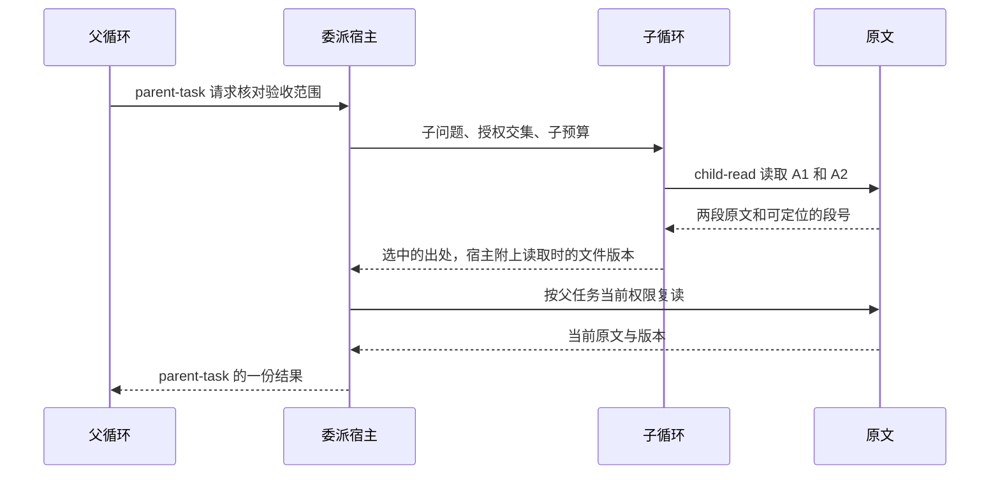

# 10 · 子 Agent，委派一次核对后父任务凭什么采用结果

用户问“导向牌的验收依据是什么”。父 Agent 把问题拆小，请子 Agent 只查“这份验收说明覆盖哪些物品”。子任务回报“找到 A2”。父任务还有理由追问。A2 在哪份资料里？子任务看的是哪一版？父任务此刻还能否打开它？

本课把两个第一课的循环嵌在一起，消息列表和工具分别传入。它们在同一个 Python 进程中按顺序运行，不需要多个云模型。工作台平时按用户选择装配一个智能体，本课的父子委派是可以独立运行的课程扩展。[本课代码](code.py) · [第一课的循环](../s01_agent_loop/code.py#L36-L47) · [工作台的单轮装配](../../src/biu_agent/agent.py#L73-L85)

## 一、什么任务值得交给子 Agent

**子 Agent**在本课中是一个接收明确子任务、持有自己的上下文和工具、按独立预算运行并返回结果的执行单元。若只是按已知 ID 取 R2，一个普通工具就够了。本例还需要在读取整份验收说明后，选出最能回答“覆盖哪些物品”的段落。这一步由子任务决定。任务拆分带来的代价是父子之间必须约定如何交接失败、版本和权限。

| 契约 | 父任务交给子任务 | 父任务保留的责任 |
| --- | --- | --- |
| 任务 | 一句关于验收范围的子问题 | 理解原问题，并决定哪种结论才算切题 |
| 能力 | 在父权限与子任务许可的交集内读取验收说明 | 不把整个父工具箱和此前所有对话一并传下去 |
| 预算 | 默认两次子决策，足够一次查询与一次选段 | 区分用尽预算、资料不可见和找不到答案 |
| 交付 | `Finding(source, version)` | 按当前权限复读正文，核对版本并判断它支撑哪句话 |

## 二、把两层循环的消息画开



[源码 · 委派时缩小权限，读取时保存文件版本](code.py#L30-L41)

```python
def review_scope(question, parent_grants, steps, keyword):
    allowed = parent_grants.intersection(TASK_SOURCES)
    version = None

    def read(call):
        nonlocal version
        if call.name != "read_scope":
            raise ValueError("子任务只能读取验收范围")
        doc = document(call.args["id"], allowed)
        version = doc["sha256"]
        passages = {f"{doc['id']}#{key}": text for key, text in doc["sections"].items()}
        return json.dumps(passages, ensure_ascii=False)
```

`TASK_SOURCES` 只含 `acceptance`。如果父任务只有到货权限，交集就是空集。即使子决策函数照例构造 `read_scope`，真正读文件的 `document` 仍会拒绝。默认权限下，工具一次取到 A1、A2，同时在宿主保存这个文件的 SHA-256。子任务无法靠自己写一段貌似可信的文字来制造这个版本。

[源码 · 给子循环独立的输入，收回一个可验证的结果](code.py#L43-L46)

```python
print("子任务收到", question, "授权", sorted(allowed))
decide = partial(decide_child, keyword=keyword)
source = run_loop(question, decide, read, steps=steps, observe=lambda event: print(" 子", event))
return Finding(source, version) if source and version else None
```

每次调用 `run_loop` 都从只含这个子问题的消息列表开始。第一步提出 `child-read`，第二步读到回执后选出含“范围”的 A2。子循环内部打印的 `Result` 供学员观察，父模型没有接收这份完整轨迹。父循环有自己的 `parent-task`，它收到的工具结果是委派宿主复核过的一段材料。[子决策的选段规则](code.py#L21-L27) · [父决策的委派请求](code.py#L59-L62)

## 三、实战，先解释正常结果，再让子任务失败

```sh
uv run --no-sync python -m tutorials.s10_subagent.code
uv run --no-sync python -m tutorials.s10_subagent.code --receiving-only
uv run --no-sync python -m tutorials.s10_subagent.code --child-steps 1
uv run --no-sync python -m tutorials.s10_subagent.code --keyword 归档
```

| 改动 | 在子任务里能看见什么 | 父结果该怎样解释 |
| --- | --- | --- |
| 默认 | `child-read` 的回执里有 A1、A2，交接的是 `acceptance#A2` | 父方回读“本次验收记录的范围仅含样品灯。”，不能推出导向牌已通过验收 |
| 父任务只有到货权限 | 子授权是 `[]`，读不到验收说明 | 返回“当前资料范围内缺少验收依据” |
| 子预算只给一步 | 日志已有两段原文，来不及再做一次决策选段 | 明确报告子任务达到步数上限 |
| 查找不存在的“归档” | 成功读到材料，但没有匹配的段落 | 报告未找到范围说明，区别于读取被拒 |

四次输出都可能有一条形式完整的父 `Result`。读这一行时还要看里面是经复核的原文、明确的不可见，还是未完成。把各类结果压成一个“子任务结束”，父任务就可能把超限误当成“没有这种记录”。[父方处理三种退出原因](code.py#L65-L78)

## 四、父任务为什么还要亲自读一遍

[源码 · 交接时核对任务范围、当前权限与版本](code.py#L49-L56)

```python
def verify_finding(finding, current_grants):
    doc, separator, section = finding.source.partition("#")
    if doc not in TASK_SOURCES or not separator or not section:
        raise Problem(409, "child_source_outside", "返回的出处不在委派范围内。")
    row = excerpt(doc, section, current_grants)
    if row["sha256"] != finding.version:
        raise Problem(409, "child_version_changed", "父子两次读取的版本不一致。")
    return f"{row['text']} [{row['source']}]"
```

这里按顺序回答了三个问题。出处是否属于本次委派的验收说明？父任务现在能否读到具体段落？两次读取的文件摘要相同吗？通过这些检查后，进入父结果的是父方自己读到的原文和定位符。子任务选择哪一段仍可能出错，这个问题要结合用户问的是什么来判断。

```sh
uv run --no-sync python -m tutorials.s10_subagent.code --handoff revoked
uv run --no-sync python -m tutorials.s10_subagent.code --handoff outside
uv run --no-sync python -m tutorials.s10_subagent.code --handoff mismatch
uv run --no-sync python -m tutorials.s10_subagent.code --keyword 通电
```

前三条命令让子任务顺利选完 A2，再在交接处分别收回父资料权限、注入一个可读但越出子任务范围的 R2、替换版本摘要。原始材料文件没有改动。应依次观察到 `not_found`、`child_source_outside`、`child_version_changed`。再对照 `--receiving-only` 和 `--handoff revoked` 的日志。前者子任务没有取到原文，后者已经有子结果，却在父方复读时失效。[交接处的三个对照](code.py#L79-L90)

最后一条没有制造任何错误数据。A1 确实写着“两台样品灯完成通电与数量检查，验收通过”，版本也一致，但它回答的是检查结果。若要证明整份记录只覆盖样品灯，A2 的范围声明才直接切题。这正是验收多 Agent 答案时需要保留原问题的理由。[两段验收原文](../../examples/tickets/data/acceptance.md)

## 五、总结与综合练习

把默认运行拆成一张交接单，填进子问题、子工具范围、退出原因、出处和版本，再填父方最终复读到的那句话。接着只改一次父权限，指出交接单的哪几项依然真实，哪一项今天已不能发表。这道题把前面的循环、工具、权限、上下文和证据检查串在了一起。

如果要从代码实验走到界面，可以拿同一问分别询问“材料助手”和“到货助手”，打开各自给出的出处，比较它们获准查看的范围。那里观察的是工作台的智能体配置。父子交接和独立预算可以继续在本章命令里单独检验。[材料工作台综合实操](../00-material-workspace/README.md) · [接入自己的系统](../01-connect-your-system.md) · [课程目录](../README.md)
